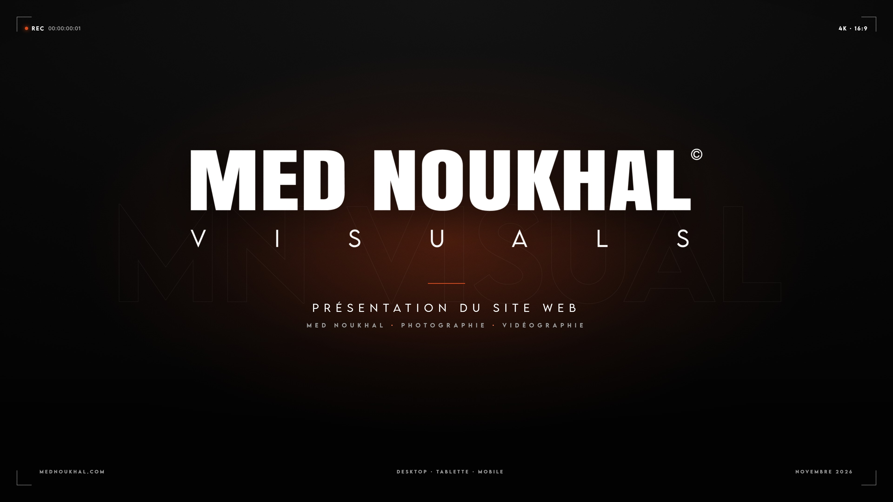
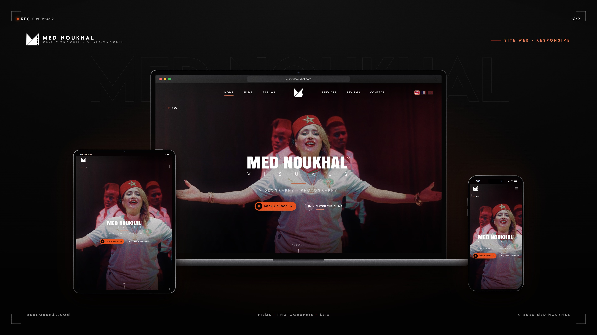
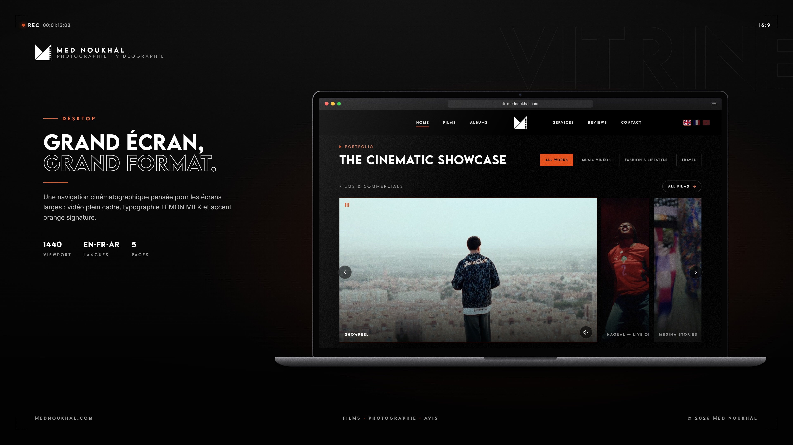
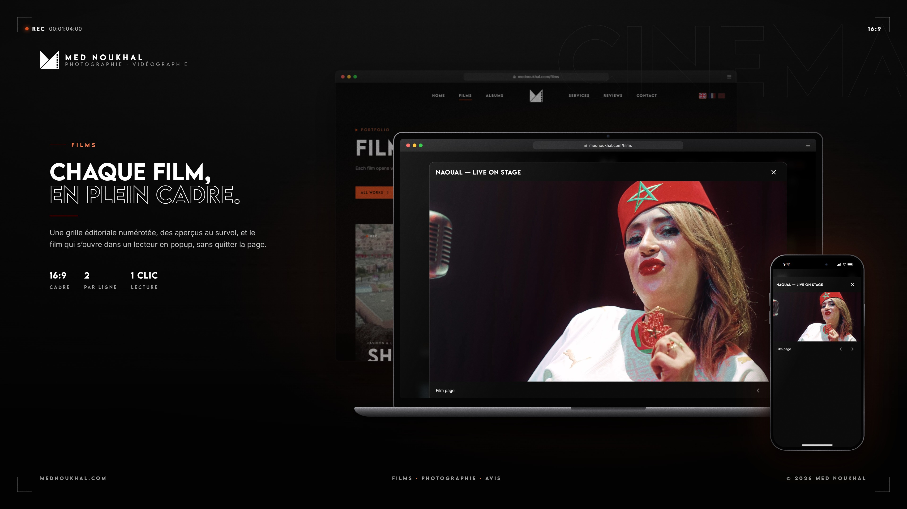
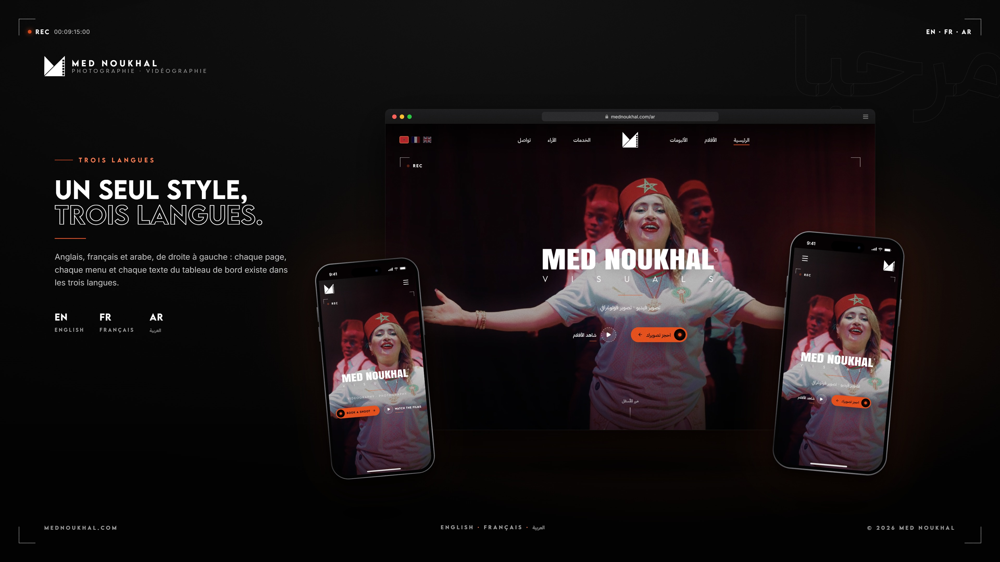
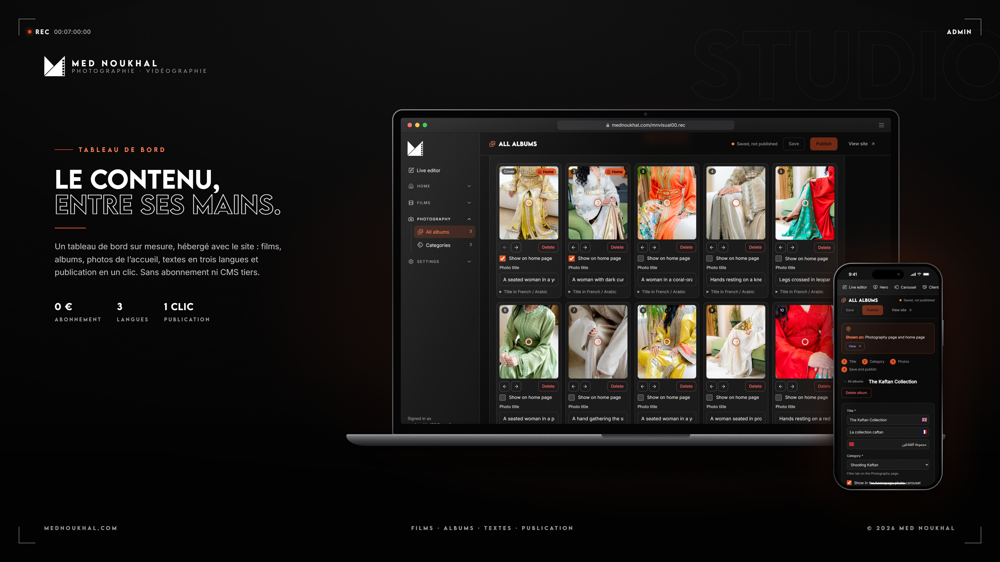
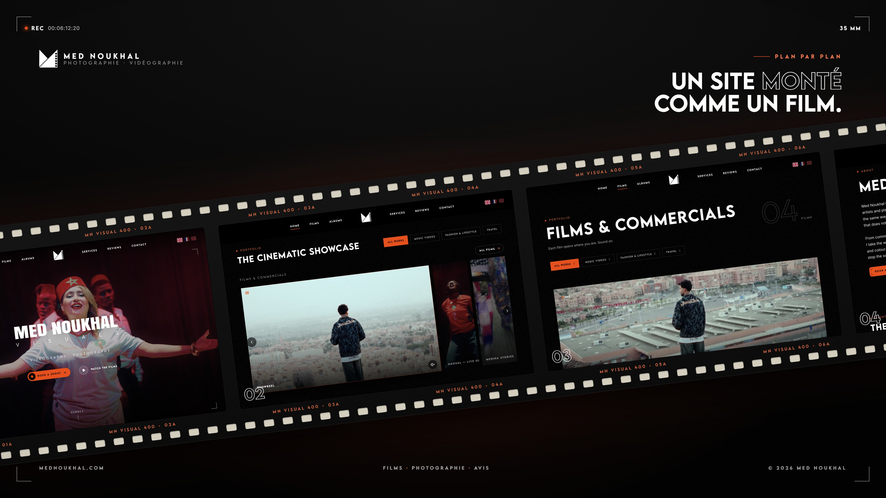
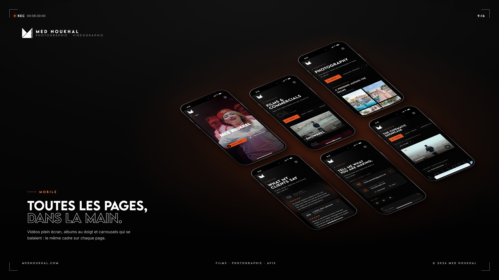
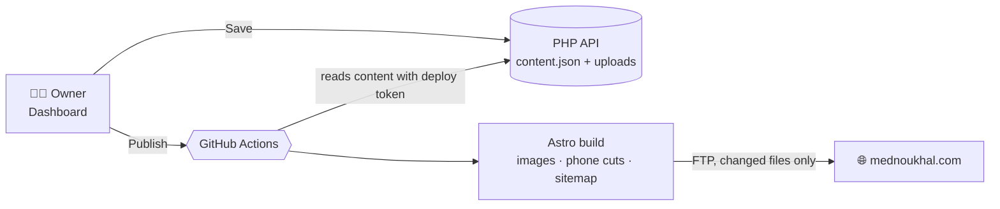
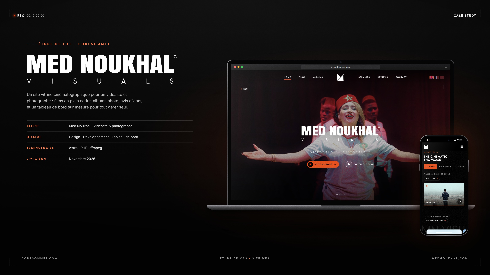

<div align="center">



<br />

# MED NOUKHAL · VISUALS

**A cinematic portfolio for a Moroccan videographer and photographer.**<br />
Films, photo albums and bookings in three languages, plus a private dashboard to manage it all.

<br />

[](https://astro.build)
[](https://www.typescriptlang.org)
[](https://www.php.net)
[](.github/workflows/deploy.yml)
[](https://www.hostinger.com)


<br />

[**Live site**](https://mednoukhal.com) &nbsp;·&nbsp; [**Mockups**](mockups/) &nbsp;·&nbsp; [**Dashboard guide**](docs/dashboard.md) &nbsp;·&nbsp; [**Instagram**](https://www.instagram.com/med_noukhal/)

</div>

<br />

---

## 🎬 &nbsp;Overview

**Med Noukhal Visuals** is the portfolio and booking site of Med Noukhal, a videographer and photographer based in Morocco. It works like a film title sequence: a dark interface, an orange accent, film grain, and the work up front.

It is a **fully static Astro site**, so it is fast, cheap to host and easy to crawl. A **small PHP dashboard** on the same hosting lets the owner change every film, album and line of text. Pressing **Publish** in the dashboard rebuilds and redeploys the site automatically.

<div align="center">

</div>

---

## ✨ &nbsp;Highlights

<table>
<tr>
<td width="50%" valign="top">

### 🎞️ Cinematic front end
- Opening preloader with the MN Visual mark
- Full-screen hero playlist, with a **9:16 phone cut made automatically** for each film
- Curved, tilted photo carousel and a sprocket-hole ticker
- Film grain, spotlight cards and motion that respects `prefers-reduced-motion`
- Films open in a popup player; photos open in a lightbox album viewer

</td>
<td width="50%" valign="top">

### 🌍 Built for reach
- Crawlable **`/`, `/fr/` and `/ar/`** pages, with full **RTL** for Arabic
- Sitemap with `hreflang`, canonical links, Open Graph and structured data
- AVIF and WebP in every size, generated at build time with `sharp`
- Videos load lazily, and nothing heavy loads until it is needed
- Static HTML: no server rendering and no database on public pages

</td>
</tr>
<tr>
<td width="50%" valign="top">

### 🛠️ Own dashboard, no SaaS
- Email and password login, password stored only as a hash
- Edit films, albums, categories, hero, clients, reviews and socials
- Every text in **EN / FR / AR**; an empty field falls back to the built-in text
- Chunked uploads (4 MB pieces) get large films past the server's upload limit
- **Save** keeps 40 backups; **Publish** goes live

</td>
<td width="50%" valign="top">

### 🚀 One-click publishing
- Publish sends a `repository_dispatch` to GitHub Actions
- The workflow pulls the content, builds the site and uploads only changed files over FTP
- Media and image caches persist between runs, so rebuilds stay fast
- Back-to-back publishes queue up instead of racing each other
- Live in roughly **3 to 5 minutes**

</td>
</tr>
</table>

---

## 🖼️ &nbsp;Gallery

<div align="center">

| Desktop | Films popup |
|:---:|:---:|
|  |  |
| **Three languages** | **Dashboard** |
|  |  |
| **Film strip** | **Mobile** |
|  |  |

<sub>All 15 mockups are in <a href="mockups/"><code>mockups/</code></a>. Open <code>mockups/index.html</code> to browse them.</sub>

</div>

---

## 🧭 &nbsp;How publishing works



---

## 🧱 &nbsp;Tech stack

| Layer | Tools |
|---|---|
| **Framework** | [Astro 7](https://astro.build), static output, directory URLs |
| **Language** | TypeScript, vanilla scripts with no UI framework |
| **Styling** | Hand-written CSS with design tokens, LEMON MILK and IBM Plex Sans Arabic |
| **Icons** | [Lucide](https://lucide.dev) |
| **Images** | `sharp`, Astro Image (AVIF / WebP) |
| **Video** | `ffmpeg` for automatic 9:16 phone cuts of the hero films |
| **Back office** | PHP API and JSON storage on Hostinger |
| **CI / CD** | GitHub Actions and FTP Deploy Action |

---

## 📁 &nbsp;Project structure

```text
mednoukhal/
├── src/
│   ├── pages/
│   │   ├── [...locale]/        # Home, films, photography, reviews, contact (EN/FR/AR)
│   │   └── <dashboard>/        # Private dashboard (path set in src/config/admin.ts)
│   ├── components/             # Header, Preloader, CurveCarousel, Theater, Lightbox…
│   ├── scripts/                # Client-side motion, carousel, lightbox, form, admin
│   ├── i18n/                   # Strings + dashboard text overlay
│   ├── data/                   # Films, photos, albums, clients, reviews
│   ├── config/                 # site.ts (identity, contact) · admin.ts
│   └── styles/                 # global.css · admin.css
├── public/
│   ├── api/                    # contact.php + dashboard API
│   └── media/                  # Films and posters
├── scripts/                    # cms-sync, media processing, phone cuts, local admin
├── docs/                       # Dashboard guide, reports, screenshots
├── mockups/                    # Presentation mockups (PNG + JPG)
└── .github/workflows/          # Build and deploy
```

---

## ⚡ &nbsp;Getting started

> **Requirements:** Node.js 24+, plus PHP 8+ for `preview` and the local dashboard. `ffmpeg` is optional and only used for the hero phone cuts.

```bash
# 1. Install
npm install

# 2. Develop (syncs dashboard content first, if configured)
npm run dev

# 3. Build the static site into dist/
npm run build

# 4. Preview the build, PHP API included
npm run preview
```

### Useful scripts

| Command | What it does |
|---|---|
| `npm run cms:sync` | Pull the dashboard content and media into the build |
| `npm run media` | Process raw media masters into web-ready files |
| `npm run admin:password` | Generate the dashboard login (email and password hash) |
| `npm run admin:token` | Generate a random deploy token |
| `npm run admin:local` | Run the dashboard locally, with Publish rebuilding in place |
| `npm run cms:seed` | Regenerate the dashboard's starting content |

### Environment

Copy `.env.example` to `.env` (it is never committed):

```ini
CMS_URL=https://mednoukhal.com   # live site that holds the dashboard content
CMS_TOKEN=                       # deploy token from api/config.php
SITE_URL=https://mednoukhal.com  # canonical links and sitemap
```

The full dashboard and deploy setup is in **[docs/dashboard.md](docs/dashboard.md)**.

---

## 🔐 &nbsp;Security notes

- The dashboard does **not** live at `/admin` or `/login`, the paths bots try first, and it is kept out of the sitemap.
- Only a **password hash** is stored on the server.
- `api/config.php`, `.env`, uploads and local content are **git-ignored**.
- Deploys never overwrite `api/config.php` or the uploaded media.

---

<div align="center">



<br /><br />

**Designed & developed by [Codesommet](https://codesommet.com/)**

<sub>© 2026 Med Noukhal Visuals. All films and photographs are the work of Med Noukhal and may not be reused without permission.</sub>

<br />

[Instagram](https://www.instagram.com/med_noukhal/) &nbsp;·&nbsp; [YouTube](https://www.youtube.com/@mednoukhal) &nbsp;·&nbsp; [Threads](https://www.threads.com/@med_noukhal)

</div>
